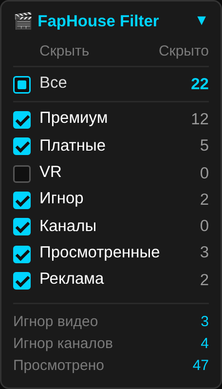
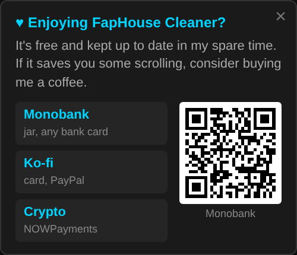

# FapHouse Cleaner

A userscript that cleans up the FapHouse video feed. It hides premium, paid and VR videos, videos and channels you've chosen to ignore, videos you've already watched, and ad blocks. You control all of it from a small panel in the corner of the page.

  

## Installation

1. Install a userscript manager:
   - [Tampermonkey](https://www.tampermonkey.net/) (Chrome, Edge, Firefox, Safari, Opera)
   - [Violentmonkey](https://violentmonkey.github.io/) (Chrome, Edge, Firefox)
2. Click this link to install the script:
   **[faphouse-cleaner.user.js](https://raw.githubusercontent.com/Common-Fool/Faphouse-cleaner/main/faphouse-cleaner.user.js)**
3. Confirm the installation in your userscript manager, then open [faphouse.com](https://faphouse.com).

### Auto-updates

The script declares `@updateURL` and `@downloadURL` pointing to this repository. Your userscript manager checks for new versions on its own schedule (once a day by default in Tampermonkey) and installs them whenever the `@version` number goes up. To check right away, use **Check for userscript updates** in the Tampermonkey menu.

> If you already have an older copy installed by hand (for example v0.8 or v1.6), install the script once from the link above. It replaces the old copy and keeps your saved lists, which are stored under the same script name.

## Features

### Filters

Each filter has a checkbox and a live count of how many videos it is hiding on the current page.

| Filter | What it hides | Default |
|---|---|---|
| **Premium** | Videos that need a fan or premium subscription | On |
| **Paid** | Pay-per-view (VOD) videos | On |
| **VR** | VR videos | Off |
| **Ignored** | Videos you added to your ignore list | On |
| **Channels** | All videos from channels you blocked | On |
| **Watched** | Videos you've already opened | On |
| **Ads** | The header banner, the "Moments" block and the exclusive-scenes promo section | On |

The **All** master checkbox turns every filter on or off at once. It shows a partial state when only some filters are on, and its counter shows the total number of hidden videos.

### Ignoring videos and blocking channels

- **Ignore a video**: hover over a thumbnail and click the round **✕** button in the corner. The video disappears and is added to the ignore list.
- **Block a channel**: hover over the channel name under a thumbnail and click the small **✕** next to it. Every video from that channel is hidden.

### Watched history

- Any video you open (left click or middle click) is marked as watched automatically.
- Videos are matched by both their ID and the code in their URL, so they're recognized across different listing pages.
- **Import from history** (📥) reads a `.csv` or `.txt` file with one video URL per line, such as an export of your browser history, and adds those videos to the watched list. Duplicates are skipped.
- **Export** (📤) downloads your watched list as `faphouse_watched.json`.
- Duplicate and broken entries are removed automatically on page load.

### Managing lists

The links at the bottom of the panel open a window for each list:

- **Ignored videos**
- **Blocked channels**
- **Watched** (the 100 most recent are shown)

In each window you can open an entry, remove a single entry, or clear the whole list.

### Other details

- **Collapsible panel**: the ▼ / ▲ button collapses the panel to just its title. The state is remembered.
- **Sync between tabs**: settings and lists update live in every open FapHouse tab.
- **Infinite scroll support**: newly loaded videos are filtered as they appear.
- **Local storage only**: all data is kept in your userscript manager's storage and never leaves your browser.
- **Donation reminder**: about once a week a small banner in the bottom-left corner suggests supporting the project. Closing it or following one of its links hides it for another week. You can also open it any time with **Support the project** in the panel.

## Support the project

If the script is useful to you, you can support its development:

  

| Method | Link |
|---|---|
| Monobank (jar, any bank card) | [send.monobank.ua/jar/6m4nBQCW9B](https://send.monobank.ua/jar/6m4nBQCW9B) |
| Ko-fi | [ko-fi.com/commonfool](https://ko-fi.com/commonfool) |
| Crypto (NOWPayments) | [nowpayments.io/donation/commonfool](https://nowpayments.io/donation/commonfool) |

## Supported sites

- `https://faphouse.com/*` and every language subdomain (`ru.faphouse.com`, `de.faphouse.com`, …), matched by `https://*.faphouse.com/*`

## Notes

- The script relies on FapHouse's page markup. If the site changes its layout, some filters may stop working until the script is updated. Please [open an issue](https://github.com/Common-Fool/Faphouse-cleaner/issues) if that happens.
